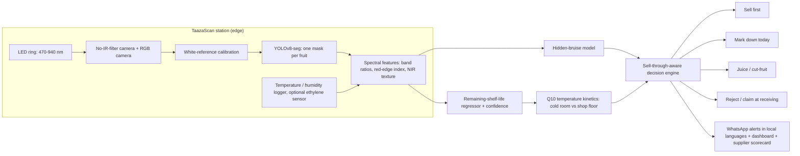

# TaazaScan: see the rot before it shows

**Team Neural Lens (IIIT Raichur)** · Everseen Computer Vision AI Hackathon 2026 (E-Cell IIT Bombay) · **Problem Statement 4: Predicting the Unseen, pre-visual food waste mitigation**

*Taaza* means "fresh". TaazaScan is a low-cost camera station that sees in both visible and **near-infrared (NIR)** light. For each fruit, it predicts **how many days are left** before spoilage becomes visible and finds **bruises under the skin** before they show. It then turns those predictions into store actions:

| Action | When | Why |
|---|---|---|
| 🟢 **Sell first** (first-expiring-first-out) | Shorter life than the rest of the display | Sells at full price before it spoils |
| 🟡 **Mark down today** | It won't sell at full price before it spoils | Recovers value, and avoids needless discounts |
| 🟠 **Juice / cut-fruit counter** | Less than half a day left | Rescues value from fruit that is still good |
| 🔴 **Reject / claim at receiving** | Hidden bruises in an incoming lot | Gives the supplier NIR image evidence |

TaazaScan never puts spoiled food back on sale. It only acts **earlier** on fruit that is still good.

## Why this matters in India

- India's post-harvest losses were valued at **₹1.53 lakh crore (about 2.35 % of GDP)** in the NABCONS 2022 study. About **15 % of guava** and **11.6 % of tomato** is lost after harvest.
- Produce often sits at **30 °C or more** in stores, mandis and quick-commerce dark stores. As a rule of thumb, ripening runs 2–3× faster for every 10 °C.
- FIFO and best-before dates can't see inside the fruit. Normal RGB cameras only notice rot once it's visible, which is already too late.

## The insight: near-infrared sees under the skin

NIR light (700–1000 nm) penetrates a few millimetres into fruit tissue:

- Water loss and cell-wall breakdown change reflectance at 850 and 940 nm.
- Chlorophyll loss shifts the red edge at 660 and 730 nm.
- Sub-surface bruises appear dark in NIR before the skin changes.

Published research backs this up:

- A low-cost NIR imaging setup detected **all** slight apple bruises right after impact and within 3 hours (IJECE).
- Hyperspectral imaging with deep learning predicts the ripeness of avocados and kiwis (Varga, Makowski & Zell, 2021).

**Our twist is multispectral imaging on a budget.** Research-grade hyperspectral cameras are expensive. Instead, we use a camera with its IR-cut filter removed and an LED ring that flashes **6 wavelengths (470 / 530 / 660 / 730 / 850 / 940 nm)** in sequence. That gives a 6-band image in under a second, built from commodity parts.

## Architecture



## What is in this repo (working now)

| File | What it does |
|---|---|
| `taazascan/sim.py` | Physics-based ripening simulator: internal degradation, Q10 temperature effect, hidden bruises. Also generates simulated RGB and NIR sensor features. |
| `run_experiments.py` | Trains the shelf-life and bruise models, then runs a 30-day store simulation. Reproduces every number in our deck (a few seconds). |
| `make_chart.py` | Draws `results/waste.png` |
| `results/metrics.json` | All results |
| `docs/` | The proposal deck (PDF) |

```bash
pip install -r requirements.txt
python run_experiments.py
python make_chart.py
```

## Results (simulated)

The test set is 5,000 fruits (banana, tomato, mango, guava), and 25 % have hidden bruises. **These are simulated results that validate the pipeline and the decision logic. Real-world accuracy will be measured on real multispectral captures.**

| Metric | RGB camera only | **TaazaScan (visible + NIR)** |
|---|---|---|
| Fruit that will spoil within 1.5 days, flagged **before anything is visible** | 3.4 % | **48.0 %** (14×) |
| Hidden-bruise detection before it's visible (AUC) | 0.52 (coin flip) | **0.85** |
| Average error in predicted days left | 0.60 days | **0.41 days** |
| Fruit wrongly flagged "sell now" (more than 3 days left) | 1.3 % | **0.2 %** |

The store simulation runs for 30 days at 30 °C, with 200 fruits arriving per day:

| Policy | Waste (% of fruit received) |
|---|---|
| Today: FIFO, thrown away when visibly spoiled | 9.7 % |
| RGB camera + our decision engine | 3.0 % |
| **TaazaScan: NIR + our decision engine** | **1.8 % (−81 % vs today)** |


There's one honest caveat. In our simple store model, the RGB-plus-decision policy recovered slightly more ₹ value (94 % vs 91 %), because it discounts less often. Tuning when to discount, using real sell-through data, is future work. Even so, the decision engine on its own delivers a large share of the benefit, and NIR roughly halves the waste that's left.

## Illustrative business case (India)

This is a hypothetical example, not a measured result.

- A store selling **₹10 lakh of fresh produce a month** loses ≈ ₹97,000 at 9.7 % waste.
- At 1.8 % waste it loses ≈ ₹18,000, a saving of **≈ ₹79,000 a month (≈ ₹9.5 lakh a year)**.
- The station's target cost is **under ₹15,000** (an estimate).
- Target users:
  - modern trade (supermarket fresh sections)
  - quick-commerce dark stores
  - mandis and FPOs (objective grading)
  - cold chain and warehouses

## Hardware (target bill of materials; all prices are estimates)

- Raspberry Pi 5 (or a Jetson Nano-class board)
- A camera module without an IR-cut filter (NoIR), plus a standard RGB camera
- Six LEDs (470, 530, 660, 730, 850, 940 nm) on a driver board, inside a light box with a white reference tile
- An SHT31 temperature and humidity sensor; optionally an ethylene / VOC gas sensor

## Datasets

| Dataset | Use |
|---|---|
| **Our ripening captures** (starting this week) | Daily 6-band scans of bananas, tomatoes and guavas over 7 days. The label is the number of days until visible spoilage. |
| **FruitNet: Indian fruits with quality** (Data in Brief; Mendeley Data) | Good, bad and mixed-quality Indian fruit images, for segmentation and the visible-stage baseline |
| **DeepHS Fruit** (Varga et al., 2021) | Public hyperspectral images of ripening avocados and kiwis, used to learn spectral ripening signatures |
| **Our simulator** (this repo) | Pipeline and decision-layer validation |

## Team Neural Lens, IIIT Raichur

Parne Abhinav Reddy (lead) · Aravind Reddy Kunareddy · Bhupathi Sri Akshith · Balisetty Tony Madhuri
